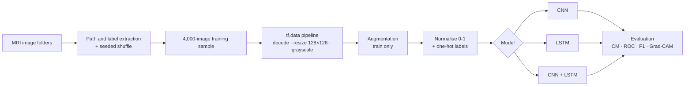

<div align="center">

# 🧠 Glioma Detection: Brain Tumor MRI Classification with Deep Learning

**Multi-class classification of brain MRI scans (Glioma · Meningioma · Pituitary · No Tumor) using CNN, LSTM and hybrid CNN-LSTM architectures, with Grad-CAM explainability.**


</div>

---

## 📑 Table of Contents

- [Overview](#-overview)
- [Key Features](#-key-features)
- [Results](#-results)
- [Dataset](#-dataset)
- [Methodology](#-methodology)
- [Model Architectures](#-model-architectures)
- [Tech Stack](#-tech-stack)
- [Project Structure](#-project-structure)
- [Getting Started](#-getting-started)
- [Usage](#-usage)
- [Evaluation and Explainability](#-evaluation-and-explainability)
- [Known Limitations](#-known-limitations)
- [Roadmap](#-roadmap)
- [Contributing](#-contributing)
- [Disclaimer](#-disclaimer)
- [License](#-license)
- [Author](#-author)
- [Acknowledgements](#-acknowledgements)

---

## 📌 Overview

Gliomas are among the most common and aggressive primary brain tumors, and early, accurate identification from MRI is critical for treatment planning. This project builds an end-to-end deep learning pipeline that classifies a brain MRI slice into one of **four classes**:

| Label | Class |
|:---:|---|
| 0 | Glioma |
| 1 | Meningioma |
| 2 | No Tumor |
| 3 | Pituitary |

Three model families are trained on the same data and compared head-to-head:

1. A **Convolutional Neural Network (CNN)**
2. A pure **LSTM** that treats image rows as a sequence
3. A hybrid **CNN + LSTM** that feeds CNN feature maps into a recurrent layer

The whole workflow (data loading, preprocessing, augmentation, training, evaluation, error analysis and Grad-CAM visualisation) lives in a single, documented Jupyter notebook.

---

## ✨ Key Features

- **Reproducible data pipeline** with fixed seeds, shuffled path/label extraction and a `tf.data` input pipeline (parallel decoding, batching, prefetching).
- **On-the-fly data augmentation**: horizontal flip, small rotation, contrast, zoom and translation.
- **Three architectures compared** under identical training settings.
- **Smart learning-rate scheduling** using a custom accuracy-threshold callback (`ReduceLROnMultipleAccuracies`) combined with `ReduceLROnPlateau`.
- **Rich evaluation**: accuracy/loss curves, confusion matrices, precision/recall/F1 reports and one-vs-rest ROC-AUC curves per class.
- **Explainable AI**: Grad-CAM heatmaps highlighting the regions that drive the CNN and CNN-LSTM predictions.
- **Error analysis**: visual side-by-side of correct versus misclassified test images for every model.
- **Step-by-step visual demos** of one-hot encoding, resizing, normalisation and each augmentation.

---

## 📊 Results

All models were trained for 50 epochs (batch size 32, Adam, initial LR `5e-4`) on a 4,000-image sample of the training set and evaluated on the full held-out test set (1,311 images).

| Model | Parameters | Test Accuracy | Test Loss |
|---|---:|---:|---:|
| **CNN** | 3,305,476 | **93.75 %** | 0.313 |
| CNN + LSTM | 147,396 | 84.97 % | 0.497 |
| LSTM | n/a | 83.07 % | 0.472 |

**Takeaways**

- The plain **CNN is the clear winner**, which is expected: convolutions exploit the 2-D spatial structure of MRI slices that recurrent models discard.
- The **CNN-LSTM** reaches ~85 % with roughly **22× fewer parameters** than the CNN, an interesting accuracy-versus-size trade-off.
- The pure **LSTM** performs worst, confirming that treating an image as a sequence of rows is a weak inductive bias for this task.
- Training accuracy for the CNN (~99 %) is noticeably higher than test accuracy (~94 %), indicating some overfitting (see [Known Limitations](#-known-limitations)).

> 💡 Add your generated plots (confusion matrices, ROC curves, Grad-CAM) to an `assets/` folder and embed them here, for example:
> ``

---

## 🗂 Dataset

The notebook expects an image-folder layout with `Training/` and `Testing/` splits, each containing one sub-folder per class. The split sizes in the notebook (**5,712 training** and **1,311 testing** images across 4 classes) match the public **Brain Tumor MRI Dataset** on Kaggle (a combination of the Figshare, SARTAJ and Br35H collections). Please verify this against your own copy and cite the original source.

```
Dataset/
├── Training/
│   ├── glioma/
│   ├── meningioma/
│   ├── notumor/
│   └── pituitary/
└── Testing/
    ├── glioma/
    ├── meningioma/
    ├── notumor/
    └── pituitary/
```

> ⚠️ The dataset is **not** included in this repository. Download it separately and update the `USER_PATH` variable in the notebook.

---

## 🔬 Methodology



1. **Data loading**: `get_data_labels()` walks each class folder, builds image-path and integer-label lists and shuffles them with a fixed seed (`SEED = 111`).
2. **Sampling**: 4,000 images are randomly drawn from the training paths.
3. **Preprocessing**: JPEGs are decoded to single-channel grayscale tensors and resized to **128 × 128**.
4. **Augmentation** (training only): `RandomFlip`, `RandomRotation`, `RandomContrast`, `RandomZoom`, `RandomTranslation`.
5. **Normalisation and encoding**: pixel values scaled to `[0, 1]`; labels one-hot encoded for categorical cross-entropy.
6. **Training**: Adam optimiser with `ReduceLROnPlateau` plus the custom threshold-based LR callback.
7. **Evaluation**: metrics, curves, error analysis and Grad-CAM.

---

## 🏗 Model Architectures

### 1. CNN
`Conv2D(32) → BN → MaxPool → Conv2D(64) → BN → MaxPool → Conv2D(128) → BN → MaxPool → Flatten → Dense(128) → Dropout(0.3) → Dense(4, softmax)`

### 2. LSTM
`Reshape(128×128) → LSTM(128, return_sequences) → Dropout(0.3) → LSTM(64) → Dropout(0.3) → Dense(64) → Dropout(0.3) → Dense(4, softmax)`

### 3. CNN + LSTM (hybrid)
`3 × [Conv2D → BN → MaxPool] → Reshape(256 × 128) → LSTM(64) → Dense(64) → Dropout(0.3) → Dense(4, softmax)`

Here the 16 × 16 spatial feature map is flattened into a 256-step sequence of 128-dimensional vectors before being fed to the recurrent layer.

---

## 🛠 Tech Stack

| Category | Tools |
|---|---|
| Language | Python 3.10 |
| Deep learning | TensorFlow / Keras |
| Data handling | NumPy, `tf.data`, scikit-learn (`shuffle`, `label_binarize`) |
| Visualisation | Matplotlib, Seaborn |
| Computer vision | OpenCV (`cv2`) |
| Metrics | scikit-learn (`confusion_matrix`, `classification_report`, `roc_curve`, `auc`) |
| Environment | Jupyter Notebook |

---

## 📁 Project Structure

```
glioma-detection/
├── Glioma_Detection.ipynb   # Complete pipeline: data → training → evaluation → Grad-CAM
├── requirements.txt         # Python dependencies
├── README.md                # Project documentation
├── LICENSE                  # License file (MIT suggested)
├── .gitignore               # Ignore datasets, checkpoints, caches
└── assets/                  # (optional) plots and screenshots for the README
```

---

## 🚀 Getting Started

### Prerequisites

- Python **3.10** (the version the notebook was developed with)
- `pip` and `venv`
- Jupyter Notebook or JupyterLab
- (Recommended) an NVIDIA GPU with CUDA/cuDNN configured for TensorFlow. The notebook also runs on CPU, but 50-epoch training will be slow.

### Installation

```bash
# 1. Clone the repository
git clone https://github.com/<your-username>/glioma-detection.git
cd glioma-detection

# 2. Create and activate a virtual environment
python -m venv venv
source venv/bin/activate        # Linux / macOS
venv\Scripts\activate           # Windows

# 3. Install dependencies
pip install -r requirements.txt
```

### Dataset Setup

1. Download the Brain Tumor MRI dataset (see [Dataset](#-dataset)).
2. Extract it so it matches the folder layout shown above.
3. Open the notebook and edit the path near the top:

```python
# Before (hard-coded Windows path)
USER_PATH = r"C:\Users\nanda\OneDrive\Documents\Capstone\Capstone\Dataset"

# After (use your own path)
USER_PATH = "./Dataset"
```

---

## 💻 Usage

```bash
jupyter notebook Glioma_Detection.ipynb
```

Run the cells from top to bottom (**Kernel → Restart & Run All**). The notebook will:

1. Load and visualise samples and class distributions
2. Build the input pipeline and show augmentation previews
3. Train the **CNN**, **LSTM** and **CNN-LSTM** models
4. Print test accuracy and loss for each model
5. Plot training curves, confusion matrices, ROC curves and Grad-CAM heatmaps
6. Display correct and incorrect predictions for each model

### Key Hyperparameters

| Parameter | Value |
|---|---|
| Image size | 128 × 128 × 1 |
| Batch size | 32 |
| Epochs | 50 |
| Optimiser | Adam (`lr = 5e-4`) |
| Loss | Categorical cross-entropy |
| Training sample | 4,000 images |
| Random seed | 111 |

### Predicting on a Single Image (example)

```python
import numpy as np
import tensorflow as tf

class_names = ["Glioma", "Meningioma", "No Tumor", "Pituitary"]

img = tf.io.read_file("path/to/mri_slice.jpg")
img = tf.image.decode_jpeg(img, channels=1)
img = tf.image.resize(img, (128, 128)) / 255.0
img = tf.expand_dims(img, axis=0)

probs = model.predict(img)[0]          # `model` = trained CNN from the notebook
print(class_names[np.argmax(probs)], f"({probs.max():.2%})")
```

> 💡 Tip: add `model.save("cnn_glioma.keras")` after training to persist the best model and reload it later with `tf.keras.models.load_model`.

---

## 🔍 Evaluation and Explainability

- **Confusion matrix and classification report**: per-class precision, recall and F1-score for every model.
- **ROC curves**: one-vs-rest AUC for each tumor class.
- **Grad-CAM**: gradient-weighted class activation maps overlaid on the MRI, showing which regions influenced the CNN and CNN-LSTM predictions (not applicable to the pure LSTM, which has no convolutional layers).
- **Error analysis**: grids of correctly and incorrectly classified test images for qualitative inspection.

---

## ⚠️ Known Limitations

Being transparent about limitations makes the project stronger. The current version has the following:

- **Test set doubles as validation set.** `validation_data=test_ds_preprocessed` is used during training and for LR scheduling, so the reported test metrics are slightly optimistic. A separate validation split is recommended.
- **Overfitting in the CNN** (≈99 % train vs ≈94 % test accuracy). Early stopping, stronger regularisation or transfer learning could help.
- **Subsampled training data.** Only 4,000 of the 5,712 training images are used.
- **Hard-coded dataset path** and **Grad-CAM layer names** (`conv2d_2`) that depend on the Keras auto-naming order and may change between runs.
- **Deprecated dependencies**: `tensorflow_addons` (end-of-life) is used only in the augmentation demo cells, and `matplotlib.cm.get_cmap` is deprecated in recent Matplotlib releases.
- **Slice-level classification only.** No patient-level splitting information is used, so slices from the same patient could appear in both sets depending on how the dataset was assembled.
- Minor typo in the class mapping (`'Meninigioma'`) and the display name `Notumor`.

---

## 🗺 Roadmap

- [ ] Replace the test-as-validation setup with a proper train / validation / test split
- [ ] Use the full training set and add early stopping with model checkpointing
- [ ] Add transfer learning baselines (ResNet50, EfficientNet, DenseNet)
- [ ] Add class-wise metrics to the results table
- [ ] Add k-fold cross-validation
- [ ] Export the best model and build a **Streamlit / Gradio** demo app
- [ ] Refactor the notebook into a modular Python package (`data.py`, `models.py`, `train.py`, `evaluate.py`)
- [ ] Add a CI workflow with linting (flake8 / ruff)
- [ ] Dockerise the project for one-command reproducibility

---

## 🤝 Contributing

Contributions, issues and feature requests are welcome!

1. Fork the repository
2. Create a feature branch: `git checkout -b feature/amazing-feature`
3. Commit your changes: `git commit -m "Add amazing feature"`
4. Push to the branch: `git push origin feature/amazing-feature`
5. Open a Pull Request

Please open an issue first to discuss any major change.

---

## ⚕️ Disclaimer

This project is for **educational and research purposes only**. It is **not a medical device** and must **not** be used for clinical diagnosis, treatment decisions or any patient-care purpose. Always consult qualified medical professionals.

---

## 📄 License

Distributed under the **MIT License**. See [`LICENSE`](LICENSE) for details.

---

## 👤 Author

**<Your Name>**

- GitHub: [@your-username](https://github.com/your-username)
- LinkedIn: [your-profile](https://www.linkedin.com/in/your-profile)
- Email: your.email@example.com

---

## 🙏 Acknowledgements

- The authors and maintainers of the **Brain Tumor MRI Dataset** (Kaggle) and its underlying sources (Figshare, SARTAJ, Br35H)
- [TensorFlow / Keras](https://www.tensorflow.org/) and [scikit-learn](https://scikit-learn.org/) communities
- Selvaraju et al., *Grad-CAM: Visual Explanations from Deep Networks via Gradient-based Localization* (ICCV 2017)

---

<div align="center">

⭐ If you found this project useful, please consider giving it a star!

</div>
